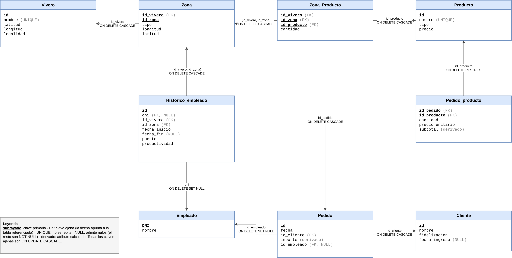
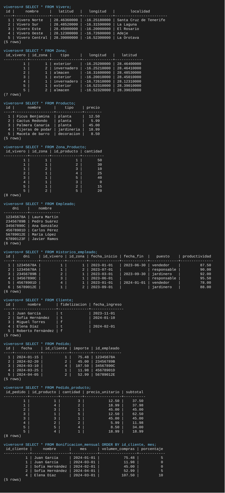

# Viveros Tajinaste S.A. — Modelo entidad-relación y modelo relacional

**Asignatura:** Administración y Diseño de Bases de Datos
**Autor:** Gabriel Becerra Martin

## Contenido del repositorio

| Fichero | Descripción |
|---|---|
| `practica 4 ABDD.drawio` | Modelo entidad-relación (editable en Draw.io) |
| `practica 4 ABDD.png` | Modelo entidad-relación en imagen |
| `modelo-relacional.png` | Diseño relacional en imagen |
| `viveros.sql` | Script de PostgreSQL que crea la base de datos `viveros`, inserta datos y ejecuta ejemplos de `DELETE` |
| `select-tablas.png` | Salida de un `SELECT` de cada tabla tras las inserciones |

## 1. Modelo entidad-relación

Notación: rectángulo = entidad, rectángulo doble = entidad débil, rombo = relación, rombo doble = relación identificadora, atributo subrayado = clave, subrayado discontinuo = clave parcial, elipse discontinua = atributo derivado. Las letras 1, N y M junto a cada línea indican el tipo de correspondencia de la relación.

### 1.1 Entidades

- **Vivero**: cada uno de los centros de venta de la empresa.
- **Zona** (entidad débil): cada una de las áreas en que se divide un vivero (zona exterior, almacén, invernadero…). No tiene sentido sin su vivero: el número de zona se repite de un vivero a otro, así que se identifica con el vivero más su número de zona.
- **Producto**: artículo que vende la empresa (plantas, productos de jardinería y decoración).
- **Empleado**: persona que trabaja en la empresa.
- **Cliente**: persona que compra en la empresa. Puede pertenecer o no al programa de fidelización *Tajinaste Plus*.
- **Pedido**: compra realizada por un cliente y gestionada por un empleado.

### 1.2 Atributos y dominios

**Vivero**

| Atributo | Dominio | Ejemplo |
|---|---|---|
| id (clave) | Entero positivo autogenerado | `1` |
| nombre | Texto de hasta 255 caracteres, no se repite | `Vivero Norte` |
| latitud | Decimal entre -90 y 90 | `28.4636` |
| longitud | Decimal entre -180 y 180 | `-16.2518` |
| localidad | Texto de hasta 255 caracteres | `La Laguna` |

**Zona**

| Atributo | Dominio | Ejemplo |
|---|---|---|
| id_zona (clave parcial) | Entero positivo, único dentro de su vivero | `2` |
| tipo | Texto de hasta 255 caracteres | `invernadero` |
| latitud | Decimal entre -90 y 90 | `28.4641` |
| longitud | Decimal entre -180 y 180 | `-16.2521` |

**Producto**

| Atributo | Dominio | Ejemplo |
|---|---|---|
| id (clave) | Entero positivo autogenerado | `3` |
| nombre | Texto de hasta 255 caracteres, no se repite | `Palmera Canaria` |
| tipo | Uno de: `planta`, `jardineria`, `decoracion` | `planta` |
| precio | Decimal con dos decimales, mayor que 0 | `45.00` |

**Empleado**

| Atributo | Dominio | Ejemplo |
|---|---|---|
| DNI (clave) | 8 dígitos seguidos de una letra mayúscula | `12345678A` |
| nombre | Texto de hasta 255 caracteres | `Laura Martín` |

**Cliente**

| Atributo | Dominio | Ejemplo |
|---|---|---|
| id (clave) | Entero positivo autogenerado | `1` |
| nombre | Texto de hasta 255 caracteres | `Juan García` |
| fidelizacion | Booleano: indica si pertenece a *Tajinaste Plus* | `true` |
| fecha_ingreso | Fecha de ingreso en *Tajinaste Plus*; vacía si no pertenece | `2023-11-01` |
| bonificacion (derivado) | Porcentaje (0, 5 o 10) calculado cada mes a partir del volumen de compras | `5` |

**Pedido**

| Atributo | Dominio | Ejemplo |
|---|---|---|
| id (clave) | Entero positivo autogenerado | `1` |
| fecha | Fecha | `2024-01-15` |
| importe (derivado) | Decimal con dos decimales, mayor o igual que 0; suma de los subtotales de sus líneas | `75.48` |

**Atributos de las relaciones**

| Relación | Atributo | Dominio | Ejemplo |
|---|---|---|---|
| Almacena | cantidad | Entero mayor o igual que 0 | `50` |
| Trabaja_en | fecha_inicio | Fecha | `2023-07-01` |
| Trabaja_en | fecha_fin | Fecha igual o posterior a la de inicio; vacía si es el destino actual | `2023-09-30` |
| Trabaja_en | puesto | Texto de hasta 255 caracteres | `jardinero` |
| Trabaja_en | productividad | Decimal entre 0 y 100 | `87.50` |
| Contiene | cantidad | Entero mayor que 0 | `3` |
| Contiene | precio_unitario | Decimal con dos decimales, mayor o igual que 0 | `12.50` |
| Contiene | subtotal (derivado) | cantidad × precio_unitario | `37.50` |

### 1.3 Relaciones y cardinalidades

- **Tiene** (Vivero – Zona, 1:N, identificadora). Un vivero tiene una o varias zonas. Cada zona pertenece obligatoriamente a un único vivero y depende de él para identificarse.
- **Almacena** (Zona – Producto, N:M). En una zona puede haber ninguno o varios productos, y un producto puede estar asignado a ninguna o a varias zonas, del mismo o de distintos viveros. El atributo `cantidad` indica las unidades disponibles de ese producto en esa zona.
- **Trabaja_en** (Empleado – Zona, N:M). Recoge el histórico de puestos. Un empleado pasa por ninguna o varias zonas a lo largo del tiempo, y por una zona pasan ninguno o varios empleados. Cada destino tiene fecha de inicio, fecha de fin, puesto y productividad.
- **Realiza** (Cliente – Pedido, 1:N). Un cliente puede hacer ninguno o varios pedidos. Cada pedido pertenece obligatoriamente a un único cliente.
- **Gestiona** (Empleado – Pedido, 1:N). Un empleado puede gestionar ninguno o varios pedidos. Cada pedido tiene un único responsable.
- **Contiene** (Pedido – Producto, N:M). Un pedido incluye uno o varios productos, y un producto puede aparecer en ninguno o en varios pedidos. Se guarda la cantidad y el precio al que se vendió.

### 1.4 Restricciones semánticas

1. Un empleado nunca tiene dos destinos a la vez: los periodos de un mismo empleado en *Trabaja_en* no se pueden solapar.
2. Un destino con `fecha_fin` vacía es el destino actual del empleado.
3. Un cliente tiene `fecha_ingreso` si y solo si pertenece a *Tajinaste Plus*.
4. La bonificación de un cliente *Tajinaste Plus* se calcula cada mes a partir del volumen de compras realizado desde su ingreso: menos de 50 € → 0 %, de 50 € a 99,99 € → 5 %, 100 € o más → 10 %.
5. El importe de un pedido es la suma de los subtotales de sus líneas.
6. Un producto que ya se ha vendido no se puede eliminar.

## 2. Modelo relacional

Clave primaria en **negrita**; las claves ajenas se indican debajo.

- VIVERO(**id**, nombre, latitud, longitud, localidad)
- ZONA(**id_vivero**, **id_zona**, tipo, latitud, longitud)
  - id_vivero → VIVERO(id)
- PRODUCTO(**id**, nombre, tipo, precio)
- EMPLEADO(**DNI**, nombre)
- CLIENTE(**id**, nombre, fidelizacion, fecha_ingreso)
- PEDIDO(**id**, fecha, id_cliente, id_empleado, importe)
  - id_cliente → CLIENTE(id)
  - id_empleado → EMPLEADO(DNI)
- ZONA_PRODUCTO(**id_vivero**, **id_zona**, **id_producto**, cantidad)
  - (id_vivero, id_zona) → ZONA(id_vivero, id_zona)
  - id_producto → PRODUCTO(id)
- PEDIDO_PRODUCTO(**id_pedido**, **id_producto**, cantidad, precio_unitario, subtotal)
  - id_pedido → PEDIDO(id)
  - id_producto → PRODUCTO(id)
- HISTORICO_EMPLEADO(**id**, dni, id_vivero, id_zona, fecha_inicio, fecha_fin, puesto, productividad)
  - dni → EMPLEADO(DNI)
  - (id_vivero, id_zona) → ZONA(id_vivero, id_zona)

Paso del modelo entidad-relación al relacional:

- Cada entidad da lugar a una tabla. La entidad débil Zona incorpora a su clave la del vivero.
- Las relaciones 1:N (*Tiene*, *Realiza*, *Gestiona*) se resuelven con una clave ajena en el lado N.
- Las relaciones N:M dan lugar a tablas propias: *Almacena* → `Zona_Producto`, *Contiene* → `Pedido_producto`, *Trabaja_en* → `Historico_empleado`.
- `Historico_empleado` tiene una clave propia (`id`) en lugar de (dni, fecha_inicio) para poder conservar el histórico cuando se elimina al empleado. La pareja (dni, fecha_inicio) se mantiene como única.
- El atributo derivado `bonificacion` no se almacena: se obtiene con la vista `Bonificacion_mensual`.

## 3. Script SQL

El script elimina la base de datos `viveros` si existe, la vuelve a crear, construye las tablas, inserta los datos, muestra el contenido de cada tabla y ejecuta los ejemplos de `DELETE`. Debe ejecutarse con `psql` porque usa `\c` para conectarse a la base de datos recién creada.

### 3.2 Atributos derivados

| Atributo | Cómo se calcula |
|---|---|
| `Pedido_producto.subtotal` | Columna generada: `GENERATED ALWAYS AS (cantidad * precio_unitario) STORED` |
| `Pedido.importe` | Disparador `trg_importe_pedido`: se recalcula al insertar, modificar o borrar una línea del pedido |
| Bonificación mensual | Vista `Bonificacion_mensual` |

### 3.3 Restricciones

- **CHECK**: rangos de latitud y longitud, precio mayor que 0, cantidades no negativas, tipo de producto dentro de una lista, formato del DNI, productividad entre 0 y 100, `fecha_fin` no anterior a `fecha_inicio`, y coherencia entre `fidelizacion` y `fecha_ingreso`.
- **EXCLUDE** en `Historico_empleado`: impide que un empleado tenga dos periodos solapados. Usa la extensión `btree_gist`.
- **UNIQUE**: nombre de vivero, nombre de producto y (dni, fecha_inicio) en el histórico.

### 3.4 Comportamiento al eliminar

Todas las claves ajenas son `ON UPDATE CASCADE`.

| Si se elimina… | Ocurre | Regla |
|---|---|---|
| un vivero | se eliminan sus zonas, el stock de esas zonas y el histórico de esas zonas | `CASCADE` |
| un producto sin ventas | se elimina su stock | `CASCADE` |
| un producto con ventas | la operación se rechaza | `RESTRICT` |
| un cliente | se eliminan sus pedidos y las líneas de esos pedidos | `CASCADE` |
| un pedido | se eliminan sus líneas | `CASCADE` |
| un empleado | sus pedidos y su histórico se conservan, sin empleado asociado | `SET NULL` |

**Decisión de diseño sobre los empleados.** Las claves ajenas hacia `Empleado` (en `Pedido` y en `Historico_empleado`) se han definido como `ON DELETE SET NULL` de forma deliberada, para que el script incluya un ejemplo de esta política además de `CASCADE` y `RESTRICT`. Al eliminar un empleado, sus pedidos y su histórico se conservan, pero dejan de indicar a qué empleado correspondían. En un sistema real no se eliminaría al empleado: se le marcaría como dado de baja (por ejemplo, con una columna `fecha_baja`) y las claves ajenas serían `RESTRICT`, de modo que siempre quedara registrado quién gestionó cada pedido y quién ocupó cada puesto.

### 3.5 Ejemplos de DELETE incluidos

1. Eliminación de una fila concreta de stock.
2. Eliminación con condición: productos sin existencias.
3. Eliminación de una línea de pedido: el importe del pedido se recalcula.
4. Eliminación de un vivero: cascada sobre zonas y stock.
5. Eliminación de un empleado: `SET NULL` en sus pedidos y en su histórico.
6. Eliminación de un cliente: cascada sobre pedidos y líneas.
7. Eliminación de un producto vendido: se rechaza (`RESTRICT`). Está comentada para que el script se importe sin errores.

### 3.6 Contenido de las tablas

Salida de un `SELECT` de cada tabla (y de la vista de bonificaciones) después de las inserciones y antes de los ejemplos de `DELETE`:

## 4. Limitaciones conocidas

- No se comprueba que la fecha de un pedido sea posterior al ingreso del cliente en *Tajinaste Plus*; la vista de bonificaciones ignora los pedidos anteriores.
- La productividad de cada destino se introduce como dato; no se calcula a partir de los pedidos.
- Al eliminar un empleado se pierde la referencia a quién gestionó sus pedidos y quién ocupó sus destinos (`SET NULL`). Es una decisión deliberada para ilustrar esta política; véase el apartado 3.4.
